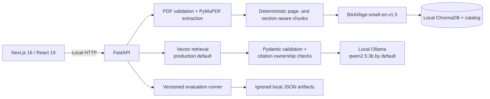

# PaperPilot AI

> A local-first workspace for turning text-based research PDFs into searchable, page-aware evidence for grounded questions, summaries, and cross-paper analysis.

PaperPilot AI is a portfolio project for exploring a practical research workflow: index papers locally, retrieve the passages behind an answer, and keep evaluation results reproducible. It is designed to support reading—not replace critical review of the original paper. The application is **not publicly hosted**.

## Overview

Research papers are difficult to search across, compare, and revisit without losing the context needed to verify a claim. PaperPilot AI addresses that workflow by extracting text from local PDFs, creating page- and section-aware chunks, storing local embeddings, and returning source passages with generated outputs.

I built the full local application: a Next.js research workspace, a FastAPI service, a PDF ingestion and retrieval pipeline, citation-constrained generation through Ollama, cross-paper comparison tools, and a versioned retrieval-evaluation workflow. The result is a local prototype that makes evidence inspection part of the interaction rather than an afterthought.

## Key features

- Validate and index text-based PDFs using PyMuPDF, deterministic section-aware chunking, local embeddings, and ChromaDB.
- Browse a paper library, search retrieved passages, and inspect the paper, page, section, and exact passage behind a result.
- Ask paper-scoped questions and generate structured summaries with citation IDs validated against retrieved chunks.
- Compare two to five papers with bounded, paper-scoped evidence and citation ownership checks.
- Generate research-gap hypotheses from selected papers. These are AI-generated hypotheses for further investigation, **not verified discoveries** or claims of literature-wide novelty.
- Run versioned local retrieval evaluations that compare the production vector baseline with an experimental deterministic hybrid candidate.

## Screenshots

> **Placeholder — no screenshots are bundled with this repository.** Add publishable captures here only after image files are committed to the repository.

| Planned capture | What it should show |
| --- | --- |
| Research workspace | Paper library, passage search, and page-aware evidence preview. |
| Grounded Q&A | A response with its returned citations and source passages. |
| Evaluation Lab | The ranking denominator, retriever metrics, and per-query changes. |

## Architecture and workflow



Processing workflow:

1. Upload a text-based PDF; the API checks its extension, supplied media type, size, header, password protection, readability, page count, and extractable text.
2. Extracted text is split into deterministic chunks that retain paper, page, section, and chunk identifiers; embeddings and the catalog stay on the local machine.
3. Search and generated workflows retrieve bounded evidence. Q&A, summaries, comparisons, and gap hypotheses validate citations against that evidence before returning results.
4. The Evaluation Lab runs the versioned dataset and saves local JSON artifacts outside Git.

For deeper implementation notes, see [architecture details](docs/ARCHITECTURE.md).

## Technology stack

| Layer | Technology |
| --- | --- |
| Frontend | Next.js 16, React 19, TypeScript |
| API | FastAPI, Pydantic |
| PDF processing | PyMuPDF |
| Retrieval | Sentence Transformers (`BAAI/bge-small-en-v1.5`), ChromaDB |
| Local generation | Ollama with `qwen2.5:3b` by default |
| Quality checks | pytest, Ruff, ESLint, Next.js build |

## Quick start on Windows

Prerequisites: Python 3.11, Node.js 24 LTS with npm, and Ollama for generated features. Start PowerShell in the repository root, then open two PowerShell windows.

```powershell
# Backend
Set-Location .\backend
py -3.11 -m venv .venv
.\.venv\Scripts\Activate.ps1
python -m pip install -r requirements-dev.txt
Copy-Item .env.example .env
python -m uvicorn app.main:app --reload --host 127.0.0.1 --port 8001
```

```powershell
# Frontend (from the repository root)
Set-Location .\frontend
Copy-Item .env.example .env.local
npm ci
npm run dev
```

Open `http://localhost:3000`, then upload a non-sensitive, text-based PDF from **Paper Library**. Interactive API documentation is available at `http://127.0.0.1:8001/docs`.

## Configuration and Ollama

Copy the committed templates before running the services:

| Template | Local copy | Purpose |
| --- | --- | --- |
| `backend/.env.example` | `backend/.env` | API, storage, model, timeout, and CORS settings. |
| `frontend/.env.example` | `frontend/.env.local` | `NEXT_PUBLIC_API_BASE_URL` for the browser client. |

The default configuration uses Ollama at `http://127.0.0.1:11434` with `qwen2.5:3b`. Model downloads are deliberately manual:

```powershell
ollama pull qwen2.5:3b
ollama serve
```

Ollama is optional for ingestion, passage search, and retrieval evaluation, but it is required for generated Q&A, summaries, comparisons, and gap hypotheses. On a 16 GB laptop, `qwen2.5:3b` is the intended small-model tradeoff and typically uses 4–6 GB RAM during generation. Cross-paper comparisons and gap analysis commonly take 1–2 minutes locally.

An optional OpenAI configuration is supported by the backend but is not required. Keep `OPENAI_API_KEY` only in `backend/.env`; never expose it through `NEXT_PUBLIC_*` variables. The default `FRONTEND_ORIGIN` is `http://localhost:3000`; change it only for a trusted frontend origin.

## Evaluation methodology and measured results

The versioned dataset at [`backend/evaluation/dataset.v1.json`](backend/evaluation/dataset.v1.json) contains 30 manually curated, page-level prompts over two local development papers. It is a small retrieval evaluation—not a general benchmark and not a measurement of answer correctness.

Four unanswerable single-paper prompts are excluded from ranking metrics, and five cross-paper prompts are manually skipped. The ranking denominator is therefore **21 answerable queries**.

| Retriever | Hit@1 | Hit@3 | Hit@5 | MRR |
| --- | ---: | ---: | ---: | ---: |
| Vector baseline (production default) | 28.57% | 61.90% | 80.95% | 0.4873 |
| Hybrid candidate (experimental) | 28.57% | 47.62% | 66.67% | 0.4135 |

The hybrid candidate regressed on this small sample and is intentionally not the production default. Manual page labels, citation IDs, and citation ownership verify linkage to retrieved text; they do **not** establish factual correctness or semantic faithfulness. Inspect the source preview and original PDF for consequential claims. Local run artifacts are written to `backend/data/evaluations/` and ignored by Git.

After indexing the dataset papers, run a fresh evaluation from `backend`:

```powershell
.\.venv\Scripts\python.exe -c "from app.api.papers import library; from app.core.config import get_settings; from app.services.evaluation import run_retrieval, save_run; settings=get_settings(); save_run(settings, run_retrieval(settings, library()))"
```

## API overview

| Route | Purpose |
| --- | --- |
| `GET /health` | Return API status, service name, version, and timestamp. |
| `POST /papers/upload` | Validate and locally index a text-based PDF; the default upload limit is 25 MB. |
| `GET /papers`, `GET /papers/{id}` | List indexed papers or inspect one paper's metadata. |
| `PATCH /papers/{id}/display-title` | Update a local display title. |
| `GET /papers/search` | Return retrieved passages only. |
| `POST /qa/ask`, `POST /qa/papers/{id}/summary` | Return citation-constrained Q&A and structured summaries. |
| `POST /research/compare`, `POST /research/gaps` | Run evidence-bounded cross-paper analysis and gap-hypothesis generation. |
| `POST /evaluation/runs`, `GET /evaluation/runs`, `GET /evaluation/runs/{run_id}` | Create and inspect reproducible local retrieval runs. |

Use the interactive API documentation at `/docs` while the backend is running for request and response schemas.

## Testing and validation

Run these checks from the repository root after completing setup:

```powershell
# Backend
Set-Location .\backend
.\.venv\Scripts\python.exe -m pytest -q
.\.venv\Scripts\python.exe -m ruff check .

# Frontend (return to the repository root first)
Set-Location ..\frontend
npm run lint
npm run build
npm audit --omit=dev
```

Continuous integration runs backend tests and linting plus frontend linting and build checks. It does not call Ollama or download models.

## Known limitations and security boundaries

- This is a local-first portfolio application, not a public or multi-user service. It has no authentication, user isolation, rate limiting, malware scanning, or public-hosting hardening; do not expose the API directly to the internet.
- CORS is configured for one trusted frontend origin. Public deployment would require deployment-specific CORS, authentication, rate limiting, secure file handling, and user isolation.
- Only text-based PDFs are supported. Scanned PDFs require OCR before indexing.
- Local models can time out, return invalid structured output, or miss relevant evidence. Retrieval and citation checks are safeguards, not guarantees of factual correctness.
- The application cannot establish peer-review quality, literature-wide novelty, or verified research discoveries. Gap output is hypothesis generation that requires independent review.
- Private PDFs, uploads, ChromaDB/catalog data, evaluation artifacts, environment files, virtual environments, Node modules, and build/cache output are excluded from Git. Before publishing, verify that no sensitive local material is tracked.

## Planned improvements

The following items are planned, not currently implemented:

- OCR support for scanned PDFs.
- Authentication, user isolation, rate limiting, and hardened file handling for a hosted deployment.
- Broader and more representative retrieval evaluation datasets.
- Further retrieval experiments that improve on the current vector baseline without weakening reproducibility.

## License

MIT. See [LICENSE](LICENSE).
