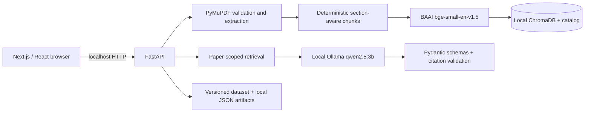

# PaperPilot AI

PaperPilot AI is a local-first research intelligence workspace for text-based PDFs. It indexes papers on your machine, returns page-aware evidence passages, produces citation-constrained Q&A and structured summaries with local Ollama, supports cross-paper analysis, and records reproducible retrieval evaluations.

It is a portfolio application—not a hosted research service or a substitute for reading the original paper.

## Features

- PDF validation, PyMuPDF extraction, deterministic section-aware chunking, local `BAAI/bge-small-en-v1.5` embeddings, and ChromaDB.
- Paper library, passage search, paper-scoped grounded Q&A, and structured summaries.
- Citation IDs validated against retrieved chunks; source previews identify the paper, page, and exact retrieved passage.
- Staged cross-paper comparison and gap hypotheses with paper-scoped citation ownership checks.
- Evaluation Lab with versioned prompts, local JSON artifacts, vector baseline versus deterministic hybrid candidate, and per-query regression display.

The default inference path is free and local: Ollama with `qwen2.5:3b`. No model is downloaded automatically. Optional OpenAI configuration is backend-only and not required.

## Architecture



See [architecture details](docs/ARCHITECTURE.md).

## Windows quick start

Requirements: Python 3.11, Node.js 24 LTS with npm, and Ollama for generated features. A 16 GB laptop is the intended minimum practical target. `qwen2.5:3b` is a small-model tradeoff: typically 4–6 GB RAM during generation, practical locally but less capable than larger models.

Open two PowerShell windows:

```powershell
# Backend
cd C:\Users\<you>\projects\paperpilot-ai\paperpilot-ai\backend
py -3.11 -m venv .venv
.\.venv\Scripts\Activate.ps1
python -m pip install -r requirements-dev.txt
Copy-Item .env.example .env
python -m uvicorn app.main:app --reload --host 127.0.0.1 --port 8000
```

```powershell
# Frontend
cd C:\Users\<you>\projects\paperpilot-ai\paperpilot-ai\frontend
Copy-Item .env.example .env.local
npm ci
npm run dev
```

Open `http://localhost:3000`. Upload a text-based PDF from **Paper Library**. API documentation is at `http://127.0.0.1:8000/docs`.

To use free local inference, explicitly install and download the model yourself:

```powershell
ollama pull qwen2.5:3b
ollama serve
```

Comparisons and gap analysis commonly take 1–2 minutes locally. Ollama running on a laptop is not a free public inference service; public deployment requires separately operated infrastructure and security controls.

## Configuration

Copy the safe committed templates:

- `backend/.env.example` → `backend/.env`
- `frontend/.env.example` → `frontend/.env.local`

`OPENAI_API_KEY` is optional and must remain only in the backend `.env`; never use it in `NEXT_PUBLIC_*` variables. The default CORS origin is `http://localhost:3000`; change `FRONTEND_ORIGIN` only to a trusted frontend origin.

## API overview

| Route | Purpose |
| --- | --- |
| `POST /papers/upload` | Validate and locally index a text-based PDF (25 MB default). |
| `GET /papers`, `GET /papers/{id}` | List or inspect indexed metadata. |
| `GET /papers/search` | Return retrieved passages only. |
| `POST /qa/ask`, `POST /qa/papers/{id}/summary` | Citation-constrained Q&A and summaries. |
| `POST /research/compare`, `POST /research/gaps` | Evidence-bounded cross-paper analysis. |
| `POST /evaluation/runs`, `GET /evaluation/runs` | Reproducible local retrieval runs. |

## Evaluation methodology and measured results

`backend/evaluation/dataset.v1.json` has 30 manually curated prompts over the two local development papers. It is a small page-level retrieval evaluation—not a general benchmark or a claim of answer correctness. Four unanswerable single-paper prompts are excluded from ranking metrics and five cross-paper prompts are manually skipped, leaving an answerable ranking denominator of **21**.

| Retriever | Hit@1 | Hit@3 | Hit@5 | MRR |
| --- | ---: | ---: | ---: | ---: |
| Vector baseline (production default) | 28.57% | 61.90% | 80.95% | 0.4873 |
| Hybrid candidate (experimental) | 28.57% | 47.62% | 66.67% | 0.4135 |

The hybrid candidate regressed on this small sample and is intentionally not the production default. Page labels are manual verification aids; a page hit, citation ID, or citation ownership validates linkage, **not** factual correctness or semantic faithfulness. Inspect source previews and the PDF for consequential claims. Local run artifacts in `backend/data/evaluations/` are intentionally ignored by Git.

Run a fresh evaluation after indexing the dataset papers:

```powershell
cd backend
.\.venv\Scripts\python.exe -c "from app.api.papers import library; from app.core.config import get_settings; from app.services.evaluation import run_retrieval, save_run; settings=get_settings(); save_run(settings, run_retrieval(settings, library()))"
```

## Checks

```powershell
# Backend
cd backend
.\.venv\Scripts\python.exe -m pytest -q
.\.venv\Scripts\python.exe -m ruff check .

# Frontend
cd ..\frontend
npm run lint
npm run build
npm audit --omit=dev
```

CI runs backend tests/lint and frontend lint/build without calling Ollama or downloading models.

## Demo script and screenshot checklist

1. Show the connected health panel and upload a non-sensitive, text-based PDF.
2. Search a phrase and open the source passage showing paper, page, section, and text.
3. Ask a supported question; open evidence previews. Show insufficient evidence separately.
4. Select two non-sensitive papers and run Compare; mention the local 1–2 minute wait and AI-assisted interpretation disclaimer.
5. Open Evaluation Lab; capture denominator, vector baseline, hybrid regression, and per-query changes.

Do not use private PDFs or screenshots that cannot be published. No screenshots are bundled.

## Security and launch boundaries

`.gitignore` excludes `.env` files, PDFs, uploads, ChromaDB/catalog data, evaluation artifacts, virtual environments, Node modules, and build/cache output. The versioned evaluation dataset and example configuration are safe to commit. Before publishing from a real Git checkout, run `git status --ignored` and `git ls-files` to verify no private documents, local database, or `.env` file is tracked.

The API is configured for a trusted local frontend origin and has no authentication, user isolation, malware scanning, rate limiting, or public-hosting hardening. Do not expose it directly to the internet. Text-only PDFs are supported; scanned PDFs need OCR. Local models can time out, return invalid structured output, or miss evidence. The application cannot establish literature-wide novelty, peer-review quality, or factual correctness.

## License

MIT. See [LICENSE](LICENSE).
