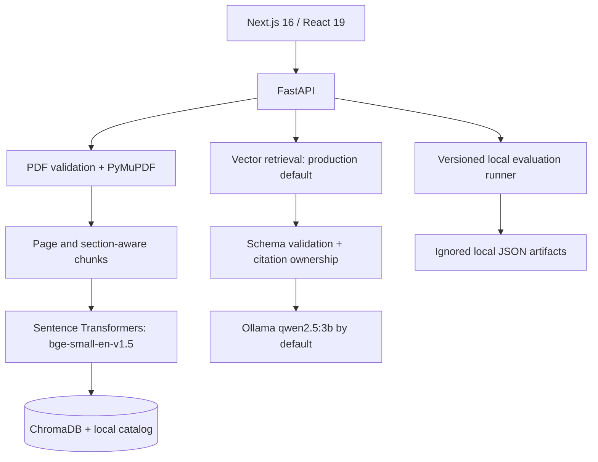

# PaperPilot AI architecture

## Boundaries

- The browser calls a configured local FastAPI base URL. API keys never reach the frontend.
- PDF uploads are checked for extension, supplied media type, size, header, password protection, readability, page count, and extractable text before indexing.
- Chunks carry paper ID, page, section, and deterministic chunk ID. Chroma vectors and catalog data are local and excluded from Git.
- Q&A, summaries, comparisons, and gaps use bounded evidence. Pydantic and paper-scoped citation checks reject invalid source references.
- The production retriever is vector-only. The deterministic hybrid lexical/section candidate remains evaluation-only because it regressed on the recorded small test set.

## Evaluation integrity

The dataset at `backend/evaluation/dataset.v1.json` is versioned; private papers and run artifacts are not. Ranking metrics include only answerable, single-paper prompts. The API artifact and UI expose the denominator, excluded unanswerable prompts, and skipped cross-paper prompts. Manual page labels are verification aids, not proof that a generated answer is factually correct.

## Operational notes

CI runs tests, lint, and build only; it does not require Ollama or private papers. Local Ollama is optional for ingestion/search/evaluation but required for generated Q&A, summaries, comparisons, and gaps. Public hosting needs authentication, rate limiting, user isolation, secure file handling, and deployment-specific CORS.
